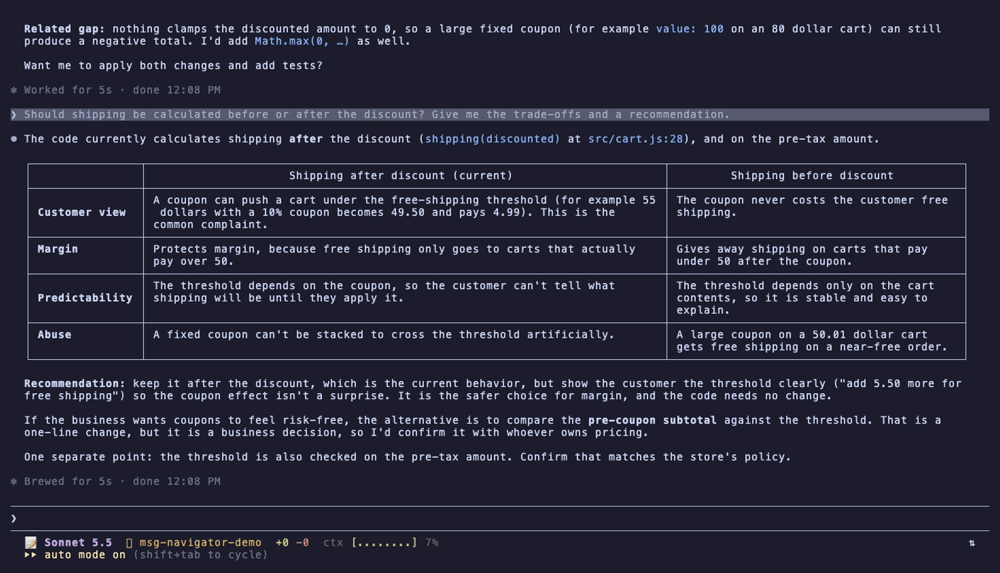
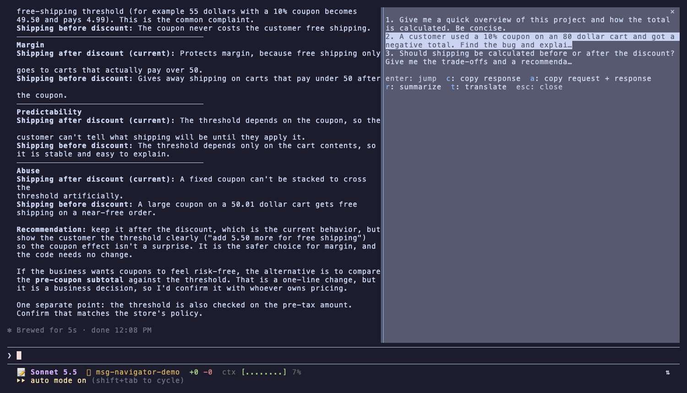
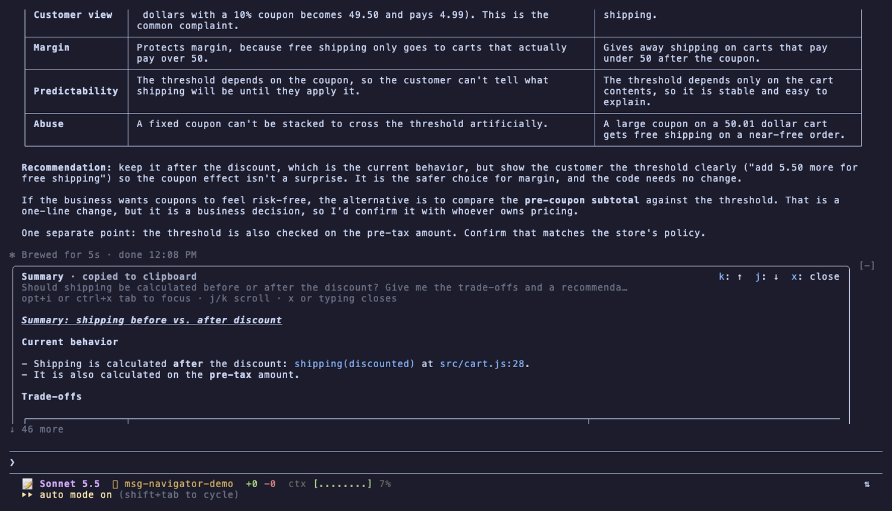
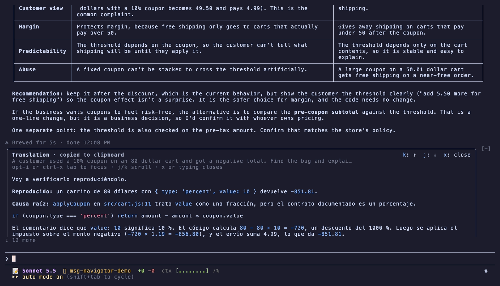

<div align="center">

# ⇅ msg-navigator

**Stop scrolling. Jump straight to any prompt in your Claude Code session, and copy, summarize or translate the answer, with one keystroke.**

[](LICENSE)
[](https://code.claude.com)


</div>

---

Long Claude Code sessions turn into a wall of text. Finding *that* answer from twenty minutes ago means scrolling, squinting and scrolling again.

**msg-navigator** gives you a picker of every prompt you typed. Pick one and you are there, or grab the answer without ever scrolling to it.

<p align="center">
  
</p>

## ⚡ Quick start

1. **Install** — at the Claude Code prompt:
   ```
   /plugin install msg-navigator --marketplace nmarmolejo/claude-code-msg-navigator
   ```
2. **Open the picker** — type `/jump` (or bind **Alt+U** / **Option+U**, see [Keyboard shortcuts](#️-keyboard-shortcuts-recommended)).
3. **Pick a prompt** with ↑ / ↓ and press **Enter** to jump, or **`c` `a` `r` `t`** to copy, copy all, summarize or translate.

## ✨ Features

| Key | What it does |
| :---: | --- |
| **Enter** | **Jump** — scroll the transcript straight to that prompt |
| **`c`** | **Copy the response** — every text block the agent wrote for it, tool noise left out |
| **`a`** | **Copy all** — request and response as clean Markdown, ready to paste into a PR, doc or chat |
| **`r`** | **Summarize** — a detailed summary that keeps decisions, commands, paths and caveats, shown in a scrollable card and copied |
| **`t`** | **Translate** — English ⇄ Spanish, code and commands left untouched, shown and copied |
| **Esc** | Close the picker |

- 🗂️ **Every prompt, always** — the list comes from the conversation itself, so it survives plugin reloads and resumed sessions.
- ⌨️ **Keyboard first** — open it with your own shortcut (Alt+U / Option+U below) or `/jump`; the newest prompt is preselected.
- 🧼 **Out of your way** — a single `⇅` glyph in the footer, no extra rows.
- 🧠 **Uses your session** — summaries and translations run through your own Claude Code credentials, no API key to set up.

## 📸 Screenshots

**The picker** — every prompt of the session, with the action keys at the bottom:



**Summarize (`r`)** — a detailed summary in a scrollable card above the prompt, already on your clipboard:



**Translate (`t`)** — English ⇄ Spanish, code and identifiers untouched:



## 🚀 Install

At the prompt of a Claude Code session:

```
/plugin install msg-navigator --marketplace nmarmolejo/claude-code-msg-navigator
```

Or from a shell:

```sh
claude plugin install msg-navigator --marketplace nmarmolejo/claude-code-msg-navigator
```

Confirm adding the marketplace (`y`), pick a scope, and start a new session.

### Requirements

- **Claude Code 2.1.317 or newer**, with plugin hooks modules (built and tested on 2.1.317).
- **The fullscreen layout.** Jumping scrolls Claude Code's own transcript; in the main-screen layout the transcript lives in your terminal's scrollback, which no plugin can move. Copy, summarize and translate work in both.

## ⌨️ Keyboard shortcuts (recommended)

Plugins cannot register keys directly, so map two of Claude Code's own actions in `~/.claude/keybindings.json`:

```json
{
  "$schema": "https://www.schemastore.org/claude-code-keybindings.json",
  "$docs": "https://code.claude.com/docs/en/keybindings",
  "bindings": [
    {
      "context": "Global",
      "bindings": { "meta+u": "app:toggleReplTab" }
    },
    {
      "context": "Chat",
      "bindings": { "meta+i": "abovePrompt:focus" }
    }
  ]
}
```

| Shortcut | Action |
| --- | --- |
| **Alt+U** (macOS: Option+U) | Open the picker (presses the `⇅` button in the footer) |
| **Alt+I** (macOS: Option+I) | Focus the summary / translation card, then `j` / `k` to scroll and `x` to close |

`meta` in `keybindings.json` is the **Alt** key on Linux and Windows, and **Option** on macOS.

> **Linux / Windows:** works out of the box in most terminals (GNOME Terminal, Konsole, kitty, Alacritty, WezTerm, Windows Terminal), which send Alt as Meta by default. If Alt+U or Alt+I opens a terminal menu or a window-manager action instead, rebind it there or pick other keys.
>
> **macOS:** your terminal must send Option as Meta (Ghostty: `macos-option-as-alt = true`; iTerm2: *Profiles → Keys → Left Option key: Esc+*).
>
> **tmux:** make sure `M-u` and `M-i` are not bound.

No shortcuts? `/jump` always opens the picker, `ctrl+x tab` focuses the card, and the mouse wheel scrolls it.

## 📖 Usage

1. Press **Alt+U** / **Option+U** (or type `/jump`).
2. Move with **↑ / ↓** — the newest prompt is selected.
3. Press **Enter** to jump, or **`c` / `a` / `r` / `t`** to copy, copy all, summarize or translate.

The summary / translation card appears above the prompt and its text is already on your clipboard. Typing in the prompt closes it.

## ⚙️ Configuration

Summaries and translations use **Sonnet** for fidelity on long technical answers. Each one is a single call billed to your session's account. Prefer faster and cheaper? Switch to Haiku:

| Setting | File |
| --- | --- |
| `SUMMARY_MODEL` | `hooks/summary.ts` |
| `TRANSLATION_MODEL` | `hooks/translation.ts` |
| `SHORTCUT_ACTION` (the action Alt/Option+U presses) | `hooks/register.tsx` |

## 🔍 How it works

- The picker reads your typed prompts from the conversation (`$.session.messages()`), slash commands left out.
- A jump scrolls the transcript to the message id the transcript drew that prompt under (`$.ui.scroll`).
- The `⇅` footer button carries an engine keybinding action, so its chord presses it from the prompt.
- Copy uses the same clipboard path as Claude Code's `/copy` (inside tmux, set `set -g set-clipboard on`).

## ⚠️ Limitations

- **Jumping needs the message to have been drawn** since the plugin loaded. After a reload or `--resume`, scroll near an older message once and it becomes jumpable; copy, summarize and translate always work.
- If you send the exact same prompt twice in a row, it is listed once.
- Plugins cannot tell `c` from `C`, so the copy actions use different letters.

## 🛠️ Development

```sh
git clone https://github.com/nmarmolejo/claude-code-msg-navigator
cd claude-code-msg-navigator
claude --plugin-dir .        # run a session with the plugin, hot-reloaded
claude plugin validate .     # manifest and hooks checks
claude plugin test .         # unit and render tests
```

Issues and pull requests are welcome.

## 📄 License

[MIT](LICENSE) © Nilson Marmolejo

<div align="center">

If msg-navigator saves you some scrolling, consider giving it a ⭐

</div>
